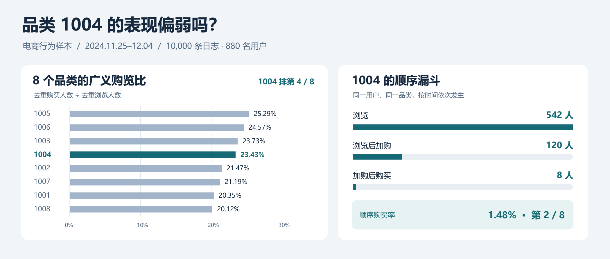

# 电商行为分析｜品类 1004 的表现偏弱吗？

**个人项目** · 指标定义、SQL 与 Python 复算、FineBI 看板、问数产品验收

观察期 2024-11-25 至 2024-12-04。清洗后 **10,000 条行为日志、880 名用户、8 个品类**。



图表由 Python（ReportLab）根据 [SQL 聚合结果](category_results.csv) 绘制。FineBI 用于原项目的看板和组合筛选验收。

## 先把比较口径对齐

原报告中，品类 1004 的购买人数 / 浏览人数为 **23.43%（127 / 542）**，全站为 **59.2%（501 / 846）**。全站用户可以在不同品类浏览或购买，两个数适合各自描述，直接用其差值判断单个品类的表现会偏离业务问题。

本次复算将基准换为同观察窗、同定义下的 8 个品类，再检查行为的时间顺序。

| 核查问题 | 品类 1004 的结果 | 可以得到的判断 |
| --- | --- | --- |
| 同口径下，购览比低于其他品类吗？ | **23.43%，第 4 / 8** | 在样本中处于中游 |
| 同一个人是否依次浏览、加购、购买？ | **542 → 120 → 8**，顺序购买率 **1.48%，第 2 / 8** | 目前没有足够依据把 1004 判为落后品类，完整路径仅 8 人，排名容易随个别行为变化 |
| 下一步核查什么？ | 浏览用户 **542 人**，在样本中居第 2 | 优先检查商品详情页曝光、库存、价格及结算链路，确认究竟在哪一步存在可解决的问题 |

**广义购览比**按品类分别统计去重购买和浏览用户，相除得到指标。**顺序漏斗**要求同一用户、同一品类内浏览 → 加购 → 购买三步时间严格递增。同一用户在同一品类只计一次完成。两种分析均限定在观察窗内。顺序口径按品类追踪，可能涉及不同 SKU，抽样日志也可能漏记中间行为，因此结果仅用于样本内诊断。

[查看 8 个品类的聚合结果](category_results.csv) · [查看顺序漏斗 SQL](category_funnel.sql)

## 从指标到产品验证

- **看板验收。** 将日期与品类筛选结果和 Python 复算对照。2024-11-30 × 1004 的组合结果为 **141 名浏览用户、18 名购买用户**。
- **实验设计。** 如果补齐详情页曝光和加购埋点后证实页面存在加购阻力，再考虑按用户固定分流测试一键加购。主指标为入组后 7 日加购用户率，购买用户率为护栏。当前为设计方案。
- **问数验收。** 通过 Figma 和 Coze 验证正常查询与超范围提示。同一套 20 题完整首测通过 12 题，完整复测通过 **19 题**。下方原型对应原报告的广义口径。

| 正常查询 | 超范围提示 |
| --- | --- |
|  |  |

## 复算

```bash
python demo.py
```

默认用 [模拟事件](sample_events.csv) 演示独立去重、次日留存和顺序漏斗。需要复算其他授权数据时，执行 `python demo.py path/to/events.csv`。CSV 包含 `user_id`、`category_id`、`behavior_type`、`timestamp`（Unix 秒），日期按 UTC+8 计算。上方聚合结果来自本地项目日志的复算。模拟样例用于检查重复事件、同秒事件及跳过阶段的边界情形。
