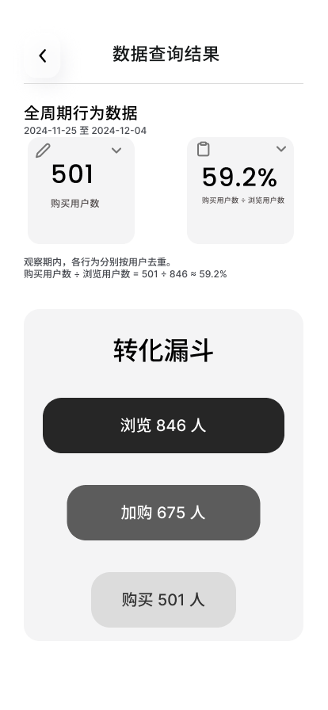
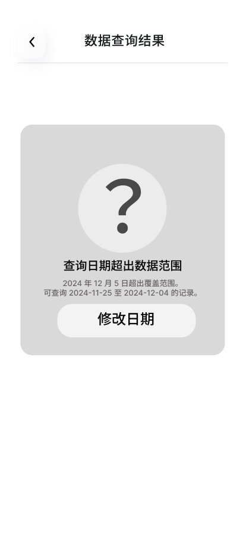

# 电商用户行为分析与问数助手

**个人项目** · MySQL / Python / FineBI / Figma / Coze

## 业务问题

让使用者能按日期和品类查到口径一致的行为、留存指标，并快速识别值得进一步排查的品类。项目覆盖数据清洗、指标建模、报告、看板和问数流程。

## 分析结果

观察期为 2024-11-25 至 2024-12-04。清洗后保留 **10,000 条行为日志、880 名用户**。

| 范围 | 去重浏览用户 | 去重购买用户 | 购买人数 / 浏览人数 |
| --- | ---: | ---: | ---: |
| 全站 | 846 | 501 | 59.2% |
| 品类 1004 | 542 | 127 | 23.43% |

两个行为分别在同一范围内按用户去重。这个比值用于描述行为分布，无法判断同一个人是否先浏览再购买。品类 1004 的结果提示优先核对库存、价格及页面信息等潜在因素，并据此提出一键加购实验。A/B 部分为实验设计。

## 数据与产品验证

- **指标口径。** 用户按观察窗内首次出现日期建队列。已观察但无人返回时次日留存记为 0，超出观察窗时记为缺失。
- **看板验收。** 用 Python 复算检查 FineBI 的日期、品类和组合筛选。2024-11-30 × 品类 1004 的筛选结果为 **141 名浏览用户、18 名购买用户**。
- **问数验收。** 设计正常查询和超范围提示。对同一套 20 题评估，完整首测通过 12 题，完整复测通过 **19 题**。

| 查询结果原型 | 超范围提示原型 |
| --- | --- |
|  |  |

## 运行 SQL 样例

在本目录运行以下命令。仅使用 Python 标准库，自动在内存中建立 SQLite 表。

```bash
python demo.py
```

样例使用自制的 [行为日志](sample_events.csv)。两份 SQL 展示 [行为去重与比值](behavior_metrics.sql) 和 [观察窗内次日留存](next_day_retention.sql)。结果用于核对口径，示例数值独立于上面的原项目结果。
