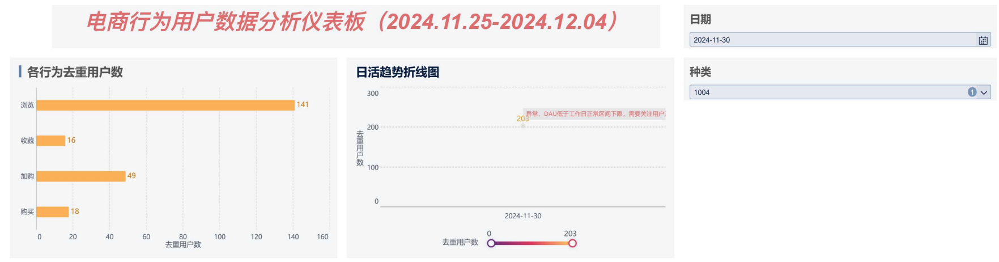

## 重点作品

| 项目 | 我的贡献 | 代表结果 |
| --- | --- | --- |
| [电商用户行为分析与问数助手](01-ecommerce/) | 独立完成 Python 数据清洗、MySQL 分层建模、FineBI 看板和问数工作流 | 分析 10,000 条行为日志，展示 FineBI 筛选验收、[24 小时顺序漏斗](01-ecommerce/growth-analysis.md)、Coze 工作流及 Figma 原型 |
| [数字技能与家庭金融决策](02-statistical-modeling/) | 负责部分数据清洗、描述性统计及论文撰写 | 全国大学生统计建模大赛省赛三等奖。团队模型基于 8,716 个有效样本，调参后测试集 AUC 为 0.884（风险参与）、0.759（保险购买） |
| [企业数据月度统计交付](03-internship/) | 与同事协作确认指标口径、采用流式分块方案并复核交付结果 | 通过分块求和与计数跑通统计导出，以日期、区域对齐验收结果 |

## 其他项目

- [广州中式轻食市场调研](04-market-research/) — 611 份有效问卷，从消费偏好和痛点推导套餐及营销建议。
